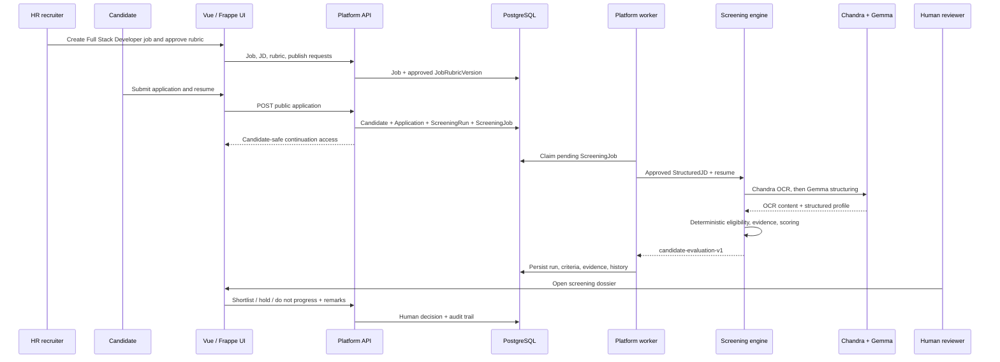
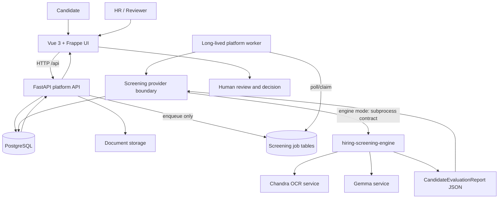
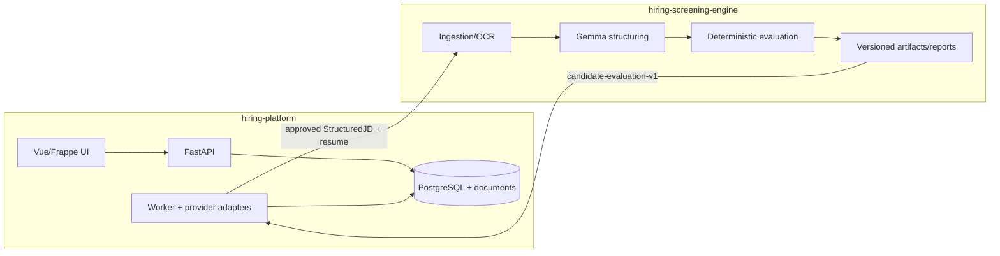
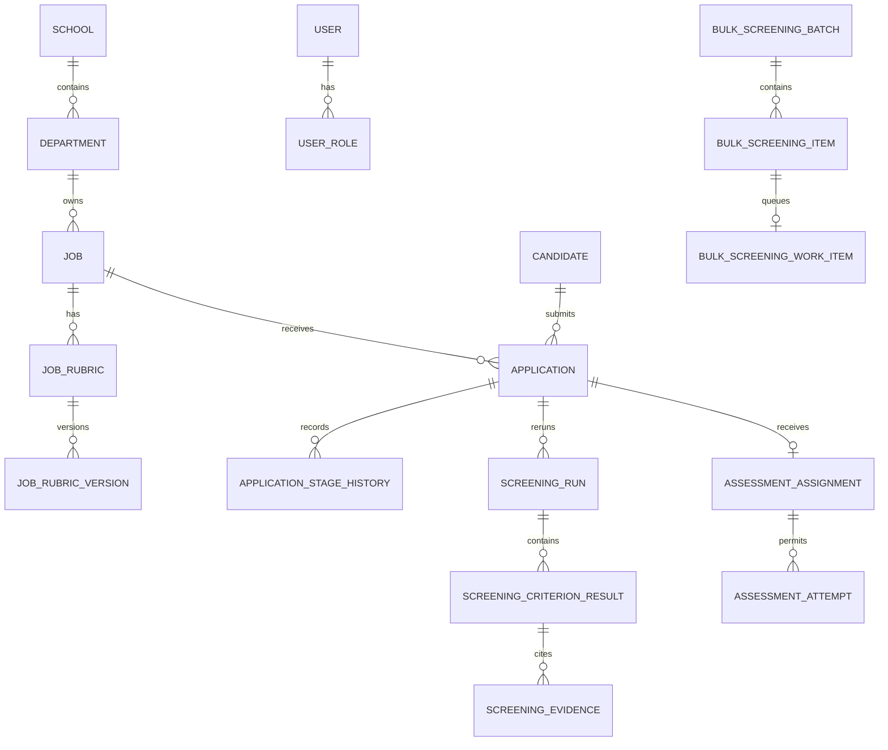

# MIT-ADT AI Hiring Project: Knowledge Transfer and Developer Onboarding

This is the canonical onboarding guide for the two repositories that make up the MIT-ADT AI Hiring project. It is written for contributors who have not seen the project before. Read it before changing either repository.

## 1. Project overview

### The problem

University recruitment combines job descriptions, many candidate documents, screening rules, assessments, interviews, and human decisions. Reviewing those materials manually is slow, but handing consequential employment decisions to a model would be unsafe and difficult to audit.

This project provides a recruitment application plus an evidence-grounded screening pipeline. The software helps staff organize hiring work, structure resumes and job descriptions, apply a deterministic rubric, and inspect the evidence behind screening results. A qualified human remains responsible for shortlisting, progression, and final hiring decisions.

### Goals

- Give candidates a public job and application flow.
- Give recruiters and reviewers a consistent job, application, screening, and audit workspace.
- Preserve the exact JD, rubric version, resume, provider version, and evidence used for each screening run.
- Use OCR and an LLM to extract structure, then use deterministic Python code for eligibility and scoring.
- Keep personally identifying or protected information outside the scoring projection.
- Process model work asynchronously so a normal API request does not wait for GPU work.
- Support both one application at a time and HR-only bulk resume screening.

### Intended users

- Candidates applying to published jobs.
- HR recruiters managing jobs and applications.
- Department reviewers and hiring managers reviewing domain fit.
- Interviewers/panel members and assessment reviewers as those modules mature.
- Hiring administrators managing access and recruitment records.
- Developers and QA contributors maintaining the platform and screening engine.

### Why AI is involved

Chandra OCR reads resume pages and Gemma converts JD/resume text into validated structured data. AI output is not trusted as a final decision. The engine validates model output with Pydantic schemas, builds a scoring-safe candidate profile, and performs eligibility, matching, experience calculation, evidence completeness, and score reconciliation in deterministic Python code.

Every `CandidateEvaluationReport` sets `human_review_required`; bulk technical failures and ambiguous evidence map to `NEEDS_REVIEW`, not automatic rejection. The platform's consequential screening actions require human remarks and write history/audit records.

### Supported recruitment scenarios

Implemented scenarios include:

- Public vacancy browsing and direct application submission.
- Application-scoped continuation access without a general candidate account.
- Staff login, jobs, approved rubric versions, application queues, and screening dossiers.
- Automatically queued individual screening with mock or configured engine providers.
- Objective assessment assignment/start/submit/scoring for configured jobs.
- Optional or required introduction-video follow-up as a document upload/skip flow; no recording or video inference.
- HR-only bulk screening against an existing approved job or an uploaded ad-hoc JD.

Interview scheduling is represented in persistence and a safe read helper, but it is not wired into candidate status and the staff scheduling workflow is not complete. The final-decision area is an audit-compatible foundation, not a complete selection/offer workflow.

## Practical walkthrough: screening one Full Stack Developer applicant

Use this example as the shortest path through the whole system.

MIT-ADT creates a **Full Stack Developer** vacancy in the platform. HR uploads the JD, generates or enters a rubric, reviews it, approves a version, and publishes the job. This happens in `hiring-platform`: the UI calls the jobs API, [`services/jobs.py`](../apps/api/app/services/jobs.py) enforces the draft/approved-rubric/publish rules, and `Job`, `Document`, `JobRubric`, and `JobRubricVersion` preserve the job and frozen screening contract. In engine-provider mode, [`services/rubrics.py`](../apps/api/app/services/rubrics.py) invokes the engine's `scripts/extract_jd.py`; Gemma proposes a validated `StructuredJD`, but HR approval determines which version becomes current.

A candidate opens the published vacancy and submits the application, resume, and required operational fields. [`App.vue`](../apps/web/src/App.vue) uses [`api/client.ts`](../apps/web/src/api/client.ts) to upload documents and call `POST /api/applications/public/jobs/{job_id}/apply`. [`submit_public_application`](../apps/api/app/services/applications.py) stores `Candidate` and `Application`, creates candidate-scoped continuation access, writes audit/history data, and calls [`enqueue_screening_run`](../apps/api/app/services/screening.py). The request returns after `ScreeningRun` and `ScreeningJob` are persisted; it does not wait for OCR or Gemma.

The long-lived [`worker.py`](../apps/api/app/worker.py) later claims the queued job. With the default mock provider, tests receive deterministic synthetic output. With `HIRING_SCREENING_PROVIDER=engine`, `HiringScreeningEngineProvider` writes the already-approved `StructuredJD`, sends the resume PDF through the engine's Chandra OCR script, asks Gemma to structure the OCR result as a `CandidateProfile`, and invokes deterministic evaluation. The engine emits a versioned `CandidateEvaluationReport` with eligibility, criterion results, evidence references, experience, completeness, warnings, and a human-review requirement.

Back in the platform, [`EngineEvaluationMapper`](../apps/api/app/services/engine_mapping.py) validates and persists the report as a `ScreeningRun`, `ScreeningCriterionResult`, and `ScreeningEvidence`. The worker moves the application to `SCREENING_REVIEW`. HR opens the screening dossier, inspects the evidence rather than only a score, and chooses shortlist, hold, or do not progress. [`transition_application`](../apps/api/app/services/workflow.py) validates that transition and writes remarks, stage history, an audit event, and a decision row. The model never makes the final hiring decision.



The key boundary is visible here: the platform owns the recruitment record and orchestration; the engine owns document understanding and evidence-backed evaluation; HR owns consequential decisions.

## 2. Why two repositories?

### `hiring-platform`

[`hiring-platform`](https://github.com/crpf-mitadt/hiring-platform) is the product application. It owns:

- Vue 3/Frappe UI screens and browser API client.
- FastAPI routes, staff and application-scoped authentication, authorization, and error responses.
- PostgreSQL persistence through SQLAlchemy and Alembic.
- Jobs, rubrics, candidates, applications, assessments, follow-up records, audit history, screening runs, and bulk screening batches.
- The durable database-backed work queues and long-lived worker loop.
- Provider adapters that invoke the engine without importing its internal scoring implementation.

### `hiring-screening-engine`

[`hiring-screening-engine`](https://github.com/crpf-mitadt/hiring-screening-engine) is a specialized Python evaluation pipeline. It owns:

- JD and resume ingestion.
- Chandra OCR calls and OCR artifacts.
- Gemma clients, prompts, response parsing, and schema repair.
- `StructuredJD`, `CandidateProfile`, `ScoringSafeProfile`, and evaluation schemas.
- Deterministic eligibility, evidence matching, experience calculation, scoring, completeness, invariants, and reports.
- CLI/scripts for running and validating the pipeline.

The engine is not a frontend, user-account system, recruitment database, or job workflow application.

### How they communicate

The platform creates a persisted screening run/work item. Its worker selects the configured provider. In engine mode, the provider executes public engine scripts as subprocesses using configured paths and environment variables. The engine emits versioned JSON artifacts; the platform validates/maps `candidate-evaluation-v1` into its own screening-run, criterion, and evidence tables.

The repositories deliberately do not share database models or deeply import each other's domain code. This separation lets students test platform workflows with a deterministic mock provider and test the engine with synthetic artifacts without needing the full web application or GPU services.

## 3. Tech stack

Versions below are manifest constraints or exact pins, not claims about every developer's installed environment.

### Platform

| Area | Verified technology |
| --- | --- |
| Frontend | Vue `^3.5`, TypeScript `^5.6`, Vite `^7.3.2` |
| Design system | Frappe UI `1.0.0-beta.54`, Frappe semantic Tailwind preset/utilities |
| Frontend testing | Vitest `^3`, Vue Test Utils `^2.4`, jsdom `^26` |
| Frontend quality | ESLint `^9`, `vue-tsc` `^3` |
| API | Python `>=3.11`, FastAPI `>=0.115`, Pydantic Settings `>=2.4` |
| Persistence | PostgreSQL 16 development container, SQLAlchemy `>=2.0.30`, psycopg `>=3.2`, Alembic `>=1.13` |
| Documents | Local filesystem storage abstraction; `pypdf>=5.0.0` for authoritative bulk-resume page validation |
| Backend tests | pytest `>=8.2`, FastAPI/HTTPX test client, Ruff `>=0.6` |
| Background work | Long-lived Python worker polling persisted PostgreSQL queue tables with bounded backoff |

The frontend has a tracked `package-lock.json`. The platform backend currently has no tracked Python lockfile; dependencies are ranges in [`pyproject.toml`](../pyproject.toml).

### Screening engine

| Area | Verified technology |
| --- | --- |
| Runtime | Python `>=3.10,<3.13`, managed with `uv` and tracked `uv.lock` |
| Validation | Pydantic `2.13.4`, Pydantic Settings `2.14.2` |
| OCR | `chandra-ocr==0.2.0`, OpenAI-compatible Chandra endpoint, `pypdfium2==5.11.0`, Pillow `12.3.0` |
| LLM | OpenAI client `2.45.0` pointed at a configured Gemma-compatible endpoint |
| Documents | Beautiful Soup, `python-docx`, PDF rendering/ingestion helpers |
| Tests | Python `unittest` unit and integration suites with synthetic/sanitized fixtures |

The model servers and GGUF weights are external runtime dependencies. They are not stored in either Git repository.

## 4. System architecture

### System context



### Repository boundary



## 5. Module-level knowledge transfer

This section maps each product area to its user behavior, implementation, APIs, persistence, dependencies, tests, and current limits. Use it to decide where a change belongs before editing code.

### Job management and rubric approval — implemented

- **Purpose and user behavior:** HR/reviewers create vacancies, attach a JD, maintain draft data, generate or enter screening criteria, approve a rubric version, publish the job, and eventually close it. Public users see published jobs only.
- **Internal implementation:** [`api/jobs.py`](../apps/api/app/api/jobs.py) exposes routes; [`services/jobs.py`](../apps/api/app/services/jobs.py) owns lifecycle and rubric approval rules; [`services/rubrics.py`](../apps/api/app/services/rubrics.py) provides mock and real-engine rubric generation. `App.vue` implements staff list/workspace and public job screens.
- **APIs:** `/api/jobs`, `/api/jobs/{id}`, JD upload, generate/list rubric versions, rubric approval, publish/close, and read-only `/api/public/jobs` routes.
- **Entities:** `School`, `Department`, `Job`, `JobReviewer`, `Document`, `JobRubric`, and `JobRubricVersion`.
- **Dependencies and invariants:** publication requires a current approved version; an approved version records source JD/hash and approved-payload hash; a changed JD requires a new version. Legal status flow is `DRAFT -> PUBLISHED -> CLOSED`.
- **Tests:** [`test_jobs_workflow.py`](../apps/api/app/tests/test_jobs_workflow.py) and rubric portions of [`test_development_seed_rubrics.py`](../apps/api/app/tests/test_development_seed_rubrics.py).
- **Limitations:** only the three-state lifecycle is implemented. Live rubric generation depends on a configured engine/Gemma runtime; the default provider is mock.

### Candidate application and continuation — implemented

- **Purpose and user behavior:** candidates browse public vacancies, submit the MIT-ADT application form and documents, receive an application-scoped continuation link, and continue assessment/video steps without a general candidate account.
- **Internal implementation:** [`api/applications.py`](../apps/api/app/api/applications.py), [`services/applications.py`](../apps/api/app/services/applications.py), [`services/application_access.py`](../apps/api/app/services/application_access.py), [`services/documents.py`](../apps/api/app/services/documents.py), and the public/candidate routes in `App.vue`. [`services/scoring_projection.py`](../apps/api/app/services/scoring_projection.py) creates the platform-side safe projection.
- **APIs:** public job reads; `/api/documents/public/resumes`; `/api/documents/public/photos`; `POST /api/applications/public/jobs/{job_id}/apply`; application-access exchange/status/assessment/video routes. An authenticated candidate-role submission route also exists.
- **Entities:** `Candidate`, `Application`, `Document`, `ApplicationAccessToken`, `ApplicationAccessSession`, `ApplicationStageHistory`, plus configured assessment/follow-up records.
- **Dependencies and invariants:** the job must be published; resume/photo documents must have the correct purpose; duplicate candidate/job applications are prevented; submission automatically queues screening. Operational PII and `scoring_safe_payload` remain separate.
- **Tests:** [`test_public_application_flow.py`](../apps/api/app/tests/test_public_application_flow.py), [`test_document_storage.py`](../apps/api/app/tests/test_document_storage.py), and candidate-access tests in [`test_application_screening_permissions.py`](../apps/api/app/tests/test_application_screening_permissions.py).
- **Limitations:** public candidate registration is intentionally absent. The candidate-safe status serializer currently does not return interview details, and the public form requires a photo even though photos never enter screening.

### Staff authentication and permissions — implemented foundation

- **Purpose and user behavior:** authorized staff sign in, receive an HttpOnly session cookie, and access role-restricted recruitment screens/APIs. Candidates and anonymous users are blocked from staff screening data.
- **Internal implementation:** [`api/auth.py`](../apps/api/app/api/auth.py), [`services/auth.py`](../apps/api/app/services/auth.py), [`api/deps.py`](../apps/api/app/api/deps.py), and [`core/security.py`](../apps/api/app/core/security.py). Passwords use PBKDF2-SHA256; only token hashes are stored.
- **APIs:** `POST /api/auth/login`, `POST /api/auth/logout`, and `GET /api/auth/me`. Route/service checks additionally enforce recruiter/reviewer/admin role sets and candidate ownership.
- **Entities:** `User`, `UserRole`, and `UserSession`; application-scoped sessions are separate.
- **Dependencies and invariants:** frontend requests include credentials; cookie security depends on environment settings; the development `X-Actor-Id` path is test/development support and must not become product UI.
- **Tests:** [`test_auth_boundaries.py`](../apps/api/app/tests/test_auth_boundaries.py) and permission tests across jobs, applications, and bulk screening.
- **Limitations:** no university SSO/external identity provider is implemented. Interviewer/proctor roles exist, but their complete product permissions/workflows do not.

### Individual application screening — implemented with mock default

- **Purpose and user behavior:** every submitted application gets a historical screening run. Staff can inspect completed/failed runs and retry a failed run without overwriting it.
- **Internal implementation:** [`services/screening.py`](../apps/api/app/services/screening.py) owns provider contracts, enqueue/idempotency, engine subprocess orchestration, retries, and job processing. [`worker.py`](../apps/api/app/worker.py) consumes pending work. [`engine_mapping.py`](../apps/api/app/services/engine_mapping.py) validates/maps the engine artifact.
- **APIs:** application submission auto-enqueues; staff can list runs, explicitly create a run for controlled operations, retry a failed run, and fetch the screening dossier. `/api/screening-jobs/run-next` exists for controlled operations and is not product UI.
- **Entities:** `ScreeningRun`, `ScreeningJob`, `ScreeningCriterionResult`, and `ScreeningEvidence`, linked to `Application`, the approved `JobRubricVersion`, and exact documents/hashes.
- **Dependencies and invariants:** screening requires a stored resume and current approved rubric. OCR/model work never runs inline in the application request. A retry creates `retry_of_run_id`; positive engine scores must retain evidence through the engine contract.
- **Tests:** [`test_screening_worker.py`](../apps/api/app/tests/test_screening_worker.py), [`test_engine_mapping.py`](../apps/api/app/tests/test_engine_mapping.py), [`test_screening_engine_provider_contract.py`](../apps/api/app/tests/test_screening_engine_provider_contract.py), and screening permission tests.
- **Limitations:** `mock` is the default provider; live Chandra/Gemma remains environment validation. The current database claim query has no explicit multi-worker `FOR UPDATE SKIP LOCKED` design.

### Bulk screening — implemented

- **Purpose and user behavior:** HR screens many resume PDFs against an approved existing job or ad-hoc JD and receives exactly three evidence-backed queues: Meets Criteria, Needs Review, and Does Not Meet.
- **Internal implementation:** [`api/bulk_screening.py`](../apps/api/app/api/bulk_screening.py), [`services/bulk_screening.py`](../apps/api/app/services/bulk_screening.py), bulk models/schemas, and [`BulkScreeningShowcase.vue`](../apps/web/src/components/BulkScreeningShowcase.vue). The same worker process consumes `BulkScreeningWorkItem` rows.
- **APIs:** supported formats; batch list/read/export; existing-job and ad-hoc creation; simplified `/api/bulk-screening/simple`; criteria confirm/reconcile; resume upload; start/resume/archive/discard.
- **Entities:** `BulkScreeningBatch`, `BulkScreeningItem`, `BulkScreeningWorkItem`, `BulkScreeningCriterionResult`, and `BulkScreeningEvidence`, plus referenced jobs/rubrics/documents/audits.
- **Dependencies and invariants:** PDF page count is server-validated with `pypdf` (1–4 accepted); ZIP safety/deduplication run before queueing; technical/incomplete cases map to `NEEDS_REVIEW`; bulk responses/CSV intentionally omit numeric scores; names/filenames cannot drive classification.
- **Tests:** the synthetic suite in [`test_bulk_screening.py`](../apps/api/app/tests/test_bulk_screening.py) covers access, uploads, parser validation, ZIP safety, queueing, progress, classification, retries, evidence, and lifecycle.
- **Limitations:** normal HR resume input is PDF only. The frontend still has an unreliable marker-based page precheck even though the server is authoritative, and dead legacy bulk markup remains gated off in `App.vue`.

### Assessments — partial

- **Purpose and user behavior:** a configured job automatically assigns a versioned objective assessment. A candidate can start/submit through application-scoped access; staff can see the result in the application workspace.
- **Internal implementation:** [`models/assessment.py`](../apps/api/app/models/assessment.py), [`services/assessments.py`](../apps/api/app/services/assessments.py), assessment schemas, application-access routes, and the candidate continuation/application workspace sections in `App.vue`.
- **APIs:** get application assessment, start assignment attempt, and submit attempt responses. There is no general staff assessment-management API.
- **Entities:** `AssessmentTemplate`, `AssessmentTemplateVersion`, `AssessmentQuestion`, `AssessmentOption`, `AssessmentAssignment`, `AssessmentAttempt`, `AssessmentResponse`, and `AssessmentResult`.
- **Dependencies and invariants:** jobs reference a template version; assignments snapshot version metadata; objective scoring is deterministic; a submitted result does not automatically shortlist or reject.
- **Tests:** assessment scenarios in [`test_public_application_flow.py`](../apps/api/app/tests/test_public_application_flow.py) and synthetic template setup in seed tests.
- **Limitations:** staff authoring/publishing/queue screens are not complete, the standalone Assessments route is informational, and broad question/assessment types are not implemented.

### Introduction video — partial

- **Purpose and user behavior:** jobs may request no, optional, or required candidate introduction video; candidate continuation supports upload or skip and staff sees status.
- **Internal implementation:** `IntroVideoMode` on `Job`, [`models/followup.py`](../apps/api/app/models/followup.py), [`services/followup.py`](../apps/api/app/services/followup.py), application-access upload/skip routes, and candidate/staff UI sections.
- **APIs:** `POST /api/applications/application-access/intro-video` and `/intro-video/skip`.
- **Entities:** `ApplicationIntroVideo` and a `Document` with introduction-video purpose.
- **Dependencies and invariants:** access is scoped to one application; the job mode must not be `NONE`; video is operational follow-up and never scoring input.
- **Tests:** video/application continuation coverage in [`test_public_application_flow.py`](../apps/api/app/tests/test_public_application_flow.py).
- **Limitations:** no recording, transcoding, playback workflow, analysis, or AI inference exists. The current skip service permits skipping both `OPTIONAL` and `REQUIRED` modes, so required-mode enforcement is incomplete.

### Human screening review — implemented

- **Purpose and user behavior:** authorized staff inspect candidate/application data, run history, criterion evidence, warnings, assessment/video status, and then shortlist for assessment, hold, or do not progress with mandatory remarks.
- **Internal implementation:** application list/dossier routes, `App.vue` application workspace, [`services/application_access.py`](../apps/api/app/services/application_access.py) for candidate isolation, and [`services/workflow.py`](../apps/api/app/services/workflow.py) for the state machine and governance records.
- **APIs:** staff application list/read, screening runs/dossier, and `/{application_id}/shortlist`, `/hold`, `/do-not-progress`.
- **Entities:** `Application`, `ApplicationStageHistory`, `HiringDecision`, `AuditEvent`, and related screening/assessment/follow-up records.
- **Dependencies and invariants:** only legal transitions are accepted; consequential human transitions require remarks; candidate-safe APIs exclude internal score/evidence/remarks and other candidates.
- **Tests:** workflow/permission cases in [`test_application_screening_permissions.py`](../apps/api/app/tests/test_application_screening_permissions.py) and auth boundary tests.
- **Limitations:** these actions govern post-screening progression, not a complete final selection/offer workflow.

### Interviews — partial foundation

- **Purpose and user behavior:** the application workspace can display whether an interview is scheduled and related instructions/status metadata.
- **Internal implementation:** `InterviewSchedule`/`InterviewStatus` in [`models/followup.py`](../apps/api/app/models/followup.py), helper reads in [`services/followup.py`](../apps/api/app/services/followup.py), and an application-workspace tab.
- **APIs:** no dedicated staff scheduling API is currently registered. Candidate status currently returns no interview record despite the safe helper.
- **Entities:** `InterviewSchedule` linked one-to-one with `Application`.
- **Dependencies and invariants:** interview information is recruitment workflow data and must remain separate from screening score/evidence.
- **Tests:** current public-flow tests create/read follow-up foundations but do not establish a complete scheduling workflow.
- **Limitations:** staff queue/scheduling, participants, rounds, rubrics, panel feedback, recording, transcription, and AI summary are not implemented.

### Final decisions — partial foundation

- **Purpose and user behavior:** retain who made a consequential decision, when, and why; preserve human ownership of hiring outcomes.
- **Internal implementation:** `HiringDecision` and `HiringDecisionType` in [`models/recruitment.py`](../apps/api/app/models/recruitment.py), records created by [`transition_application`](../apps/api/app/services/workflow.py), dossier history, and an informational Final Decisions route.
- **APIs:** shortlist/hold/do-not-progress create current decision rows through workflow endpoints. There is no complete final-decision route group.
- **Entities:** `HiringDecision`, `ApplicationStageHistory`, and `AuditEvent`.
- **Dependencies and invariants:** actor/timestamp/mandatory remarks are preserved; AI, assessment, and proctoring outputs cannot make the final decision.
- **Tests:** human-decision remarks and invalid-transition cases in [`test_application_screening_permissions.py`](../apps/api/app/tests/test_application_screening_permissions.py).
- **Limitations:** selected/not-selected/another-round orchestration, panel sign-off, offers, and onboarding are not complete product workflows.

## 6. AI screening pipeline

### Engine stages

The canonical data path is:

```text
JD source -> StructuredJD
resume PDF -> Chandra OCR -> CandidateProfile -> ScoringSafeProfile
StructuredJD + ScoringSafeProfile -> eligibility + criteria + evidence
-> CandidateEvaluationReport -> platform persistence -> HR review
```

| Stage | What happens | AI or deterministic? | Primary engine entry points | Output used next |
| --- | --- | --- | --- | --- |
| JD ingestion | TXT/MD/DOCX/embedded-text PDF content is read; scanned PDF fallback can use OCR through the full workflow. | Deterministic parsing; Chandra only for scanned fallback | [`ingestion/jd_document.py`](https://github.com/crpf-mitadt/hiring-screening-engine/blob/3162575b1a15ecdb53b354da927c78340062f94c/src/chandra_eval/ingestion/jd_document.py), `scripts/extract_jd.py` | Normalized JD text/source identity |
| JD structuring | Requirements, skills, minimum experience, and linked rubric criteria are proposed and schema-validated. Deterministic post-processing corrects required/preferred classification and emits grounding warnings. | Gemma extraction plus deterministic validation/post-processing | [`pipeline/jd_structuring.py`](https://github.com/crpf-mitadt/hiring-screening-engine/blob/3162575b1a15ecdb53b354da927c78340062f94c/src/chandra_eval/pipeline/jd_structuring.py), [`schemas/jd.py`](https://github.com/crpf-mitadt/hiring-screening-engine/blob/3162575b1a15ecdb53b354da927c78340062f94c/src/chandra_eval/schemas/jd.py) | `StructuredJD` (`structured-jd-v1`) |
| Resume extraction | Each PDF page is rendered, sent to Chandra, and recorded with page/block source maps, completion, truncation, and failure metadata. | Chandra OCR plus deterministic artifact handling | [`ocr/full_document.py`](https://github.com/crpf-mitadt/hiring-screening-engine/blob/3162575b1a15ecdb53b354da927c78340062f94c/src/chandra_eval/ocr/full_document.py), `scripts/run_full_resume_ocr.py` | OCR document, metadata, source map |
| Resume structuring | OCR content becomes education, experience, skills, projects, publications, and provenance. Invalid JSON/schema output has bounded repair paths; date recovery/normalization follows. | Gemma extraction plus deterministic validation/date recovery | [`pipeline/resume_structuring.py`](https://github.com/crpf-mitadt/hiring-screening-engine/blob/3162575b1a15ecdb53b354da927c78340062f94c/src/chandra_eval/pipeline/resume_structuring.py), [`schemas/resume.py`](https://github.com/crpf-mitadt/hiring-screening-engine/blob/3162575b1a15ecdb53b354da927c78340062f94c/src/chandra_eval/schemas/resume.py), `scripts/structure_resume.py` | `CandidateProfile` (`candidate-profile-v1`) |
| Safety projection | Personal information is excluded while job-relevant evidence/provenance is retained. | Deterministic Python | [`safety/candidate_sanitizer.py`](https://github.com/crpf-mitadt/hiring-screening-engine/blob/3162575b1a15ecdb53b354da927c78340062f94c/src/chandra_eval/safety/candidate_sanitizer.py), `ScoringSafeProfile` schema | `ScoringSafeProfile` (`scoring-safe-profile-v1`) |
| Eligibility and criteria | Mandatory gates, linked requirements, required/preferred/adjacent components, degree/experience rules, and evidence matches are evaluated. Experience intervals are normalized/merged and uncertainty is retained. | Deterministic Python; no model owns the score | [`scoring/eligibility.py`](https://github.com/crpf-mitadt/hiring-screening-engine/blob/3162575b1a15ecdb53b354da927c78340062f94c/src/chandra_eval/scoring/eligibility.py), [`scoring/engine.py`](https://github.com/crpf-mitadt/hiring-screening-engine/blob/3162575b1a15ecdb53b354da927c78340062f94c/src/chandra_eval/scoring/engine.py), experience/evidence modules | `EligibilityResult` + `CriterionEvaluation[]` |
| Evidence and scoring reconciliation | Evidence is deduplicated by document/page/block/text identity; discrete match fractions, weights, completeness, gates, warnings, strengths, and gaps are reconciled and invariant-checked. | Deterministic Python | scoring modules and `scripts/validate_evaluation_invariants.py` | Validated evaluation fields |
| Evaluation report | The canonical artifact records schema/scoring versions, eligibility, criteria, evidence, experience, completeness, and `human_review_required`. JSON/CSV/HTML are projections of it. | Deterministic serialization/reporting | [`schemas/evaluation.py`](https://github.com/crpf-mitadt/hiring-screening-engine/blob/3162575b1a15ecdb53b354da927c78340062f94c/src/chandra_eval/schemas/evaluation.py), `pipeline/candidate_evaluation.py`, `reports/` | `CandidateEvaluationReport` (`candidate-evaluation-v1`) |

The standalone `chandra-eval match` command orchestrates all stages through `pipeline/match_workflow.py`. The platform adapter deliberately takes a narrower route: rubric generation may call `extract_jd.py`, but an application screening run reuses the human-approved `StructuredJD` and calls resume OCR, resume structuring, and `evaluate_candidate.py`. This prevents a screening run from silently replacing the approved rubric.

### Important concepts

- `StructuredJD` contains mandatory/preferred requirements and a linked scoring rubric.
- `CandidateProfile` may retain operational personal data, but `ScoringSafeProfile` contains only job-relevant evidence fields.
- Eligibility is `PASS`, `REVIEW`, or `FAIL` and remains separate from the weighted score.
- Criteria preserve required/core, preferred, adjacent/transferable, controlled-equivalent, and evaluation-dimension components.
- Positive criterion scores require source-backed `EvidenceRef` entries with document/page/block identity.
- Experience ranges are normalized and overlapping confirmed ranges are not double-counted.
- Evidence completeness combines supported criteria with date/OCR quality diagnostics.
- Deterministic invariants reject unsupported schema versions, invalid rubric weights/IDs, source-class contradictions, arithmetic drift, and evidence-free positive scores.

### Platform integration

[`screening.py`](../apps/api/app/services/screening.py) defines the provider protocol, mock provider, engine provider, enqueue/retry logic, and individual job processing. [`engine_mapping.py`](../apps/api/app/services/engine_mapping.py) maps the versioned engine artifact into `ScreeningRun`, `ScreeningCriterionResult`, and `ScreeningEvidence`. The platform does not copy scoring logic.

Engine mode uses the approved platform `structured_jd_payload`; it does not silently regenerate a frozen rubric. For PDF resumes, the adapter calls the engine OCR/structuring/evaluation scripts. JSON resumes are supported only as a controlled structured integration/test path.

### Multi-designation JDs

[`structured_jd_contract.py`](../apps/api/app/services/structured_jd_contract.py) detects Assistant Professor, Associate Professor, and Professor requirements and can filter requirements/criteria for a selected designation. Current bulk behavior also supports no selection: it validates/evaluates one canonical variant per detected designation and retains the strongest classification (`MEETS_CRITERIA` over `NEEDS_REVIEW` over `DOES_NOT_MEET_CRITERIA`). This is screening classification aggregation, not a final hiring decision.

### Persistence, progress, retries, and errors

- Individual screening stores immutable runs plus separate queue jobs; retries create a new run linked by `retry_of_run_id`.
- Bulk screening stores a batch, items, work items, criterion results, and evidence. Processing stages/progress are committed so polling can see durable progress.
- The worker persists attempts, start/completion/failure timestamps, safe failure codes/messages, provider/engine versions, hashes, and model endpoint slot.
- Individual failures move the application to human review. Retriable bulk failures can be requeued while completed items remain intact. Systemic bulk failures stop pending items rather than continuing with a broken shared JD/configuration.
- Historical results are retained; reruns do not overwrite the original artifact identity.

## 7. Codebase walkthrough

### Platform tree

```text
hiring-platform/
├── apps/
│   ├── api/app/
│   │   ├── api/          FastAPI route groups and dependencies
│   │   ├── core/         settings, security helpers, error handling
│   │   ├── db/           SQLAlchemy base/session
│   │   ├── models/       persisted domain entities
│   │   ├── schemas/      public request/response contracts
│   │   ├── services/     domain rules, providers, workflows, audit
│   │   ├── tests/        synthetic API/service tests
│   │   ├── main.py       application factory/router registration
│   │   └── worker.py     once/continuous queue consumer
│   └── web/
│       ├── src/App.vue   route state, product screens, workflow composition
│       ├── src/api/      typed browser API client/contracts
│       ├── src/components/BulkScreeningShowcase.vue
│       └── package.json  frontend commands/dependencies
├── alembic/              migration environment and versions
├── docs/                 architecture, operations, and this KT
├── docker-compose.yml    development PostgreSQL only
└── pyproject.toml        backend package/test/lint configuration
```

Important files and why they exist:

- [`apps/api/app/main.py`](../apps/api/app/main.py): creates FastAPI, CORS/error handlers, and `/api` route registration.
- [`apps/api/app/core/config.py`](../apps/api/app/core/config.py): the verified `HIRING_` settings contract.
- [`apps/api/app/api/deps.py`](../apps/api/app/api/deps.py): database, staff-session/development-actor, and application-scoped access dependencies.
- [`apps/api/app/models/recruitment.py`](../apps/api/app/models/recruitment.py): job/rubric/candidate/application/stage/decision entities and enums.
- [`apps/api/app/services/workflow.py`](../apps/api/app/services/workflow.py): legal application transitions, mandatory remarks, history, and audit/decision creation.
- [`apps/api/app/services/applications.py`](../apps/api/app/services/applications.py): public/authenticated submission, candidate-safe serialization, and auto-enqueue.
- [`apps/api/app/services/scoring_projection.py`](../apps/api/app/services/scoring_projection.py): strips blocked personal/operational fields from the platform's scoring projection.
- [`apps/api/app/services/screening.py`](../apps/api/app/services/screening.py): individual screening provider and durable-run lifecycle.
- [`apps/api/app/services/bulk_screening.py`](../apps/api/app/services/bulk_screening.py): bulk validation, snapshots, queueing, execution, classification, progress, retries, archive, and export behavior.
- [`apps/api/app/worker.py`](../apps/api/app/worker.py): long-lived consumer shared by individual and bulk jobs.
- [`apps/web/src/App.vue`](../apps/web/src/App.vue): current route parser and public/candidate/staff page compositions. There is no Vue Router configuration; browser history/path parsing is implemented here.
- [`apps/web/src/components/BulkScreeningShowcase.vue`](../apps/web/src/components/BulkScreeningShowcase.vue): approved simplified JD/resume bulk-screening experience reused inside the staff shell.
- [`alembic/versions`](../alembic/versions): authoritative database evolution; do not replace migrations with `create_all` in deployed environments.

To trace a public application: `App.vue` -> `api/client.ts publicApply` -> `api/applications.py api_public_apply` -> `services/applications.py submit_public_application` -> `services/screening.py enqueue_screening_run` -> `worker.py` -> provider -> `engine_mapping.py` -> screening dossier API/UI.

### Engine tree

```text
hiring-screening-engine/
├── src/chandra_eval/
│   ├── ingestion/       JD/resume source reading
│   ├── ocr/             Chandra client, page rendering, OCR artifacts
│   ├── llm/             Gemma client, prompts, JSON/response handling
│   ├── pipeline/        JD/resume structuring and end-to-end workflow
│   ├── safety/          prohibited attributes and safe projection
│   ├── schemas/         strict versioned Pydantic contracts
│   ├── scoring/         deterministic matching/scoring/invariants
│   ├── reports/         canonical report projections
│   ├── cli.py           `chandra-eval` command
│   └── config.py        model/service settings
├── scripts/             stage, evaluation, report, matrix, acceptance tools
├── tests/               unit/integration synthetic and sanitized regressions
├── docs/                architecture, scoring, privacy, runbooks
├── pyproject.toml        exact Python dependency pins
└── uv.lock              reproducible dependency lock
```

Start with the engine's [`docs/system-architecture.md`](https://github.com/crpf-mitadt/hiring-screening-engine/blob/3162575b1a15ecdb53b354da927c78340062f94c/docs/system-architecture.md) and [`docs/scoring-invariants.md`](https://github.com/crpf-mitadt/hiring-screening-engine/blob/3162575b1a15ecdb53b354da927c78340062f94c/docs/scoring-invariants.md). Trace a full run from [`cli.py`](https://github.com/crpf-mitadt/hiring-screening-engine/blob/3162575b1a15ecdb53b354da927c78340062f94c/src/chandra_eval/cli.py) into `pipeline/match_workflow.py`, then the structuring and scoring files described above.

## 8. Data model and APIs

### Primary relationships



Other implemented entities include `Document`, `AuditEvent`, `HiringDecision`, staff `UserSession`, application access tokens/sessions, assessment templates/versions/questions/options/responses/results, `ApplicationIntroVideo`, and `InterviewSchedule`.

### Important route groups

- `/api/auth`: staff login/logout/current session.
- `/api/public/jobs` and `/api/jobs`: public vacancy reads and staff job/rubric lifecycle.
- `/api/documents`: validated resume/photo uploads.
- `/api/applications`: public/authenticated submission, application-scoped follow-up, staff lists/dossiers, and human screening actions.
- `/api/bulk-screening`: formats, batches, simple/multi-step creation, upload/start/resume/archive/export.
- `/api/dashboard`: implemented recruitment counts.
- `/api/screening-jobs/run-next`: controlled operations endpoint; not product UI.

Representative verified contracts (IDs and data are synthetic):

```http
GET /api/health

200 OK
{"status":"ok"}
```

```http
POST /api/auth/login
Content-Type: application/json

{"email":"recruiter@example.org","password":"<development-password>"}

200 OK
{"id":"<user-id>","email":"recruiter@example.org","full_name":"Synthetic Recruiter","roles":["hr_recruiter"]}
```

The login response also sets the configured HttpOnly staff-session cookie. Do not put real passwords in documentation or fixtures.

```http
POST /api/bulk-screening/simple
Content-Type: multipart/form-data

jd_file=<JD file>
files=<resume.pdf>
files=<another-resume.pdf>
target_designation=<optional designation>
```

The response is a `BulkScreeningBatchRead` containing batch identity/status/counts, criteria snapshot, safe document metadata, and item statuses/classifications/reasons/evidence. Numeric score fields are intentionally absent from the bulk response and CSV export.

For exact request/response fields, use [`schemas/jobs.py`](../apps/api/app/schemas/jobs.py), [`schemas/applications.py`](../apps/api/app/schemas/applications.py), [`schemas/screening.py`](../apps/api/app/schemas/screening.py), and [`schemas/bulk_screening.py`](../apps/api/app/schemas/bulk_screening.py). These are more reliable than copying examples into client code.

## 9. Development environment

### Prerequisites

- Git.
- Platform: Python 3.11, Node/npm compatible with the tracked lockfile, and PostgreSQL 16 (the Compose option is development-only).
- Engine: Python 3.10–3.12 and `uv`.
- GPU/model endpoints only for live Chandra/Gemma validation. They are not required for ordinary unit tests.

### Clone both sibling repositories

```bash
mkdir -p ~/Documents/MIT-ADT/Server/Hiring
cd ~/Documents/MIT-ADT/Server/Hiring
git clone https://github.com/crpf-mitadt/hiring-platform.git
git clone https://github.com/crpf-mitadt/hiring-screening-engine.git
```

Ask the maintainer which feature/integration branch to use; do not assume `develop` exists. Never put a `.git` repository around the parent `Hiring/` directory.

### Platform backend reference setup

The platform currently uses pip/setuptools, not a tracked `uv.lock`:

```bash
cd ~/Documents/MIT-ADT/Server/Hiring/hiring-platform
python3.11 -m venv .venv
.venv/bin/python -m pip install -e '.[dev]'
cp .env.example .env
```

Edit `.env` with local placeholders. Never commit real credentials, model paths, candidate data, or server-specific personal configuration.

Development PostgreSQL and migrations:

```bash
docker compose up -d postgres
.venv/bin/alembic upgrade head
.venv/bin/alembic current
```

Reference process commands (run only in an environment where local runtime execution is authorized):

```bash
.venv/bin/uvicorn app.main:app --app-dir apps/api --reload --host 127.0.0.1 --port 8010
PYTHONPATH=apps/api .venv/bin/python -m app.worker --poll-interval 2 --max-poll-interval 30
```

### Platform frontend reference setup

```bash
cd ~/Documents/MIT-ADT/Server/Hiring/hiring-platform/apps/web
npm ci
```

The Vite proxy uses `VITE_API_PROXY_TARGET`; production builds may use `VITE_API_BASE_URL`. Relative `/api` calls are intentional in development so HttpOnly cookies round-trip on one browser origin. The current local-workflow policy in [`development.md`](development.md) says not to run installs/services on the local Mac unless explicitly authorized; follow the maintainer's environment-specific direction.

### Engine setup

```bash
cd ~/Documents/MIT-ADT/Server/Hiring/hiring-screening-engine
uv sync --frozen
```

Copy `.env.example` only when configuring live services. The key engine settings include Chandra/Gemma base URLs/models, request timeouts, token budgets, and `PIPELINE_DEBUG_RAW_RESPONSES`. Keep raw-response debugging false unless private data handling has been explicitly approved.

### Working without GPU access

- Platform tests use the mock screening/rubric providers and synthetic documents.
- Engine unit/integration tests use synthetic/sanitized fixtures and mock clients.
- The engine's synthetic pilot and Phase 1 acceptance path do not require live model services.
- Live OCR/LLM validation requires configured Chandra/Gemma endpoints and belongs in the controlled AI server environment, not ordinary student laptops.

## 10. Testing guide

Run only commands permitted in your current environment. These commands are verified against the repositories' manifests/configuration; they were not executed as part of this documentation-only change.

### Platform backend

```bash
cd ~/Documents/MIT-ADT/Server/Hiring/hiring-platform
.venv/bin/python -m pytest
.venv/bin/python -m ruff check .
.venv/bin/python -m compileall apps/api/app
```

Tests cover API/service behavior, authentication/permissions, public applications, scoring-safe projection, job/rubric lifecycle, worker behavior, provider mapping/contracts, document storage, and bulk screening. [`conftest.py`](../apps/api/app/tests/conftest.py) uses an isolated in-memory SQLite database for fast tests; PostgreSQL/Alembic still require separate environment validation.

Focused examples:

```bash
.venv/bin/python -m pytest apps/api/app/tests/test_screening_worker.py
.venv/bin/python -m pytest apps/api/app/tests/test_bulk_screening.py
.venv/bin/python -m pytest apps/api/app/tests/test_application_screening_permissions.py
```

### Platform frontend

```bash
cd ~/Documents/MIT-ADT/Server/Hiring/hiring-platform/apps/web
npm test
npm run typecheck
npm run lint
```

`npm run build` exists in `package.json`, but it is not prescribed as a required local student validation step. The frontend suite mocks Frappe UI/API boundaries, tests route/workflow behavior and the bulk showcase, and includes a static Frappe UI design-conformance check.

### Screening engine

```bash
cd ~/Documents/MIT-ADT/Server/Hiring/hiring-screening-engine
uv sync --frozen
uv run python -m unittest discover -s tests -v
uv run python scripts/run_phase1_acceptance.py --output /tmp/chandra-phase1-acceptance --force
```

The full suite covers schemas, OCR artifacts/coverage, JD and resume structuring, safety, dates/experience, deterministic scoring, source provenance, invariants, reports, caching/workflow, CLI, and synthetic integration. The acceptance runner is a maintained synthetic gate, not live-model QA.

### Database and API contracts

- Review each Alembic migration and verify `alembic current`/`upgrade head` against PostgreSQL in an authorized integration environment.
- Treat Pydantic response schemas and `candidate-evaluation-v1` as versioned contracts.
- Platform mapper/provider tests prove artifact mapping with fixtures; they do not prove a live Chandra/Gemma deployment.

### Mocked versus live validation

Mocked tests are deterministic, fast, and safe for students. They prove code paths, permissions, state transitions, persistence, and contract handling. Live AI validation additionally proves service reachability, model compatibility, OCR quality, extraction quality, token/time limits, and real subprocess configuration. Never report a mocked test as live AI validation.

## 11. Contribution workflow

The following policy is **PROPOSED** until repository settings and CI workflows are actually configured. Neither audited repository currently tracks a `.github/workflows` CI file, and this audit did not verify an existing `develop` branch.

1. Start from the maintainer-designated integration/base branch and create a small feature branch, for example `student/<name>/<issue>`.
2. Keep engine and platform changes in their own repositories/commits. Link paired PRs when a contract changes across repositories.
3. Add or update synthetic tests with the code change.
4. Run the permitted repository checks and record exactly what passed.
5. Push the feature branch and open a PR into the protected integration branch selected by maintainers.
6. Require proposed CI checks and code-owner/maintainer review before merge.
7. Do not push directly to protected branches, force-push shared history, rewrite reviewed commits, or deploy directly to a server.
8. Never commit real resumes/JDs, candidate PII, OCR/model outputs, `.env` secrets, model weights, or personal server paths.

Proposed branch protection: require PRs, passing backend/frontend/engine checks as applicable, at least one code-owner approval, resolved review conversations, and no force pushes. A maintainer must configure these rules; documentation does not make them active.

## 12. Security and hiring safety

### Authentication and authorization

- Staff use password login and hashed HttpOnly session tokens (`UserSession`). Passwords use PBKDF2-SHA256.
- Public applicants receive a one-time application token, exchanged for an HttpOnly session scoped to one application.
- The API checks role sets and application ownership at service/route boundaries.
- A development `X-Actor-Id` provider remains available when `actor_provider=development` and the environment/allow flag permits it. It must be disabled for production and is not a production identity solution.

Implemented roles are Candidate, HR Recruiter, Department Reviewer, Interviewer, Proctor, and Hiring Administrator. Route permissions are narrower than the role enum where functionality is incomplete; see [`permissions.md`](permissions.md) and tests rather than assuming every role can use every endpoint.

### PII and scoring safety

Operational application data can include name, email, phone, DOB, gender, mother tongue, salary, address-like information, and photo. These fields must not be passed to scoring. The platform projection blocks personal/contact/demographic/salary/photo/video fields, and the engine's scoring-safe schema excludes `personal_information`.

Use only synthetic or explicitly sanitized fixtures. Do not log tokens, credentials, raw resumes, or model responses. Raw LLM response persistence is disabled by default for privacy.

### Decision governance

- AI output is decision support, never the final hiring authority.
- Technical failures, incomplete evidence, and proctoring signals must not automatically reject a candidate.
- Candidate-safe APIs do not expose internal AI scores, evidence, reviewer remarks, or other candidates.
- Bulk screening intentionally exposes classifications/reasons rather than numeric ranking.
- Video must not be used for sensitive-trait, appearance, facial-characteristic, accent, emotion, or personality inference.

## 13. Current status

| Feature | Status | Repository | Relevant files | Notes / limitations |
| --- | --- | --- | --- | --- |
| Public jobs and direct application | Implemented | Platform | `App.vue`, `api/jobs.py`, `api/applications.py` | Requires published job, stored resume/photo, configured fields. |
| Staff session authentication | Implemented | Platform | `services/auth.py`, `api/auth.py` | No external/SSO identity provider. |
| Application-scoped candidate access | Implemented | Platform | `services/application_access.py` | One application per scoped session; no public candidate registration. |
| Roles and permission tests | Implemented | Platform | `models/user.py`, `core/security.py`, permission tests | Interviewer/proctor product permissions remain limited. |
| Job lifecycle and organization | Implemented | Platform | `models/recruitment.py`, `services/jobs.py` | Draft/publish/close only. |
| Rubric versions/approval/freeze | Implemented | Platform | `services/jobs.py`, `services/rubrics.py` | Provider defaults to mock; live generation needs configured engine. |
| Individual async screening | Implemented | Platform | `services/screening.py`, `worker.py` | DB queue; mock default. Live engine runtime needs verification. |
| Engine OCR/structuring/scoring | Implemented | Engine | `ocr/`, `pipeline/`, `scoring/` | Code and synthetic tests exist; live model quality/environment remain external validation. |
| Evidence dossier and human screening actions | Implemented | Platform | screening models, `workflow.py`, application workspace | Remarks/audit/history enforced for consequential actions. |
| Bulk screening | Implemented | Platform | bulk models/service/API, `BulkScreeningShowcase.vue` | PDF resumes only in normal UI; classifications are not final decisions. |
| Continuous worker | Implemented | Platform | `worker.py` | Polling/backoff process; supervisor/deployment config intentionally external. |
| Objective assessments | Partial | Platform | assessment models/service, candidate continuation UI | Candidate attempt/scoring implemented; full staff authoring/queue is not. |
| Introduction video | Partial | Platform | follow-up model/service/API/UI | Upload/skip metadata only; no recording, processing, or AI analysis. |
| Interview workflow | Partial | Platform | `models/followup.py`, application workspace | Persistence/read helper exists; no staff scheduling API, and candidate status currently returns no interview record. |
| Final hiring decision | Partial | Platform | `HiringDecision`, `workflow.py`, placeholder page | Screening decisions recorded; full final selection/offer workflow incomplete. |
| Proctoring | Planned | Platform | Role enum/future boundary only | No browser surveillance or automatic rejection. |
| Offers/onboarding/employee HRMS | Planned | Platform | None | Outside current implemented scope. |
| CI and branch protection | Needs verification | Both | No tracked workflows | Proposed policy only; repository settings were not changed/audited through admin APIs. |
| Production deployment | Planned / external | Both | Reference docs and environment settings | No production process-manager/orchestration architecture in this milestone.

## 14. Glossary and FAQ

### Glossary

- **OCR:** Optical Character Recognition; turns rendered resume pages into machine-readable structured text/layout.
- **LLM:** Large Language Model; Gemma is used here to structure text, not to own final scoring/arithmetic.
- **StructuredJD:** Versioned validated representation of a JD, requirements, skills, and scoring rubric.
- **Rubric:** Weighted criteria and links to JD requirements used to evaluate evidence consistently.
- **Eligibility:** Independent `PASS`/`REVIEW`/`FAIL` result for mandatory requirements.
- **Evidence dossier:** Internal staff view of screening runs, criterion results, source evidence/provenance, warnings, and history.
- **Screening classification:** Bulk result group: meets criteria, needs review, or does not meet verified hard criteria. It is not a hiring decision.
- **Worker:** Long-lived process that consumes queued screening jobs outside API requests.
- **Queue:** Persisted database rows representing pending/running/completed/failed work.
- **Migration:** Ordered Alembic code that evolves the PostgreSQL schema.
- **Platform API:** The `/api` HTTP contract used by the Vue application; Pydantic schemas define its request/response shapes.
- **Engine contract:** The subprocess/environment and versioned artifact boundary by which the platform invokes the sibling engine.
- **Role-based access:** Platform permissions based on the six role values plus candidate/application ownership checks.

### FAQ

**Do I need Chandra, Gemma, or a GPU to start?**

No. Use mock providers and synthetic/unit tests. Live model validation is a separate controlled step.

**Where should I add a new page or recruitment API?**

Usually in `hiring-platform`. Put reusable recruitment rules in services, not Vue components or route handlers.

**Where should I change matching, eligibility, evidence, or score behavior?**

In `hiring-screening-engine`, with invariant/regression tests. Do not duplicate scorer logic in the platform.

**Can the platform import engine internals directly?**

The current design uses versioned artifacts and a provider boundary. Reuse public engine scripts/contracts; avoid coupling platform models to internal scorer functions.

**Why do candidates not see the AI score?**

Internal evidence/score/reviewer rationale is restricted to authorized staff. Candidate APIs return a safe progress/status projection.

**Does `FAIL` reject a candidate?**

No. It can support a screening classification when a hard-gate failure is verified, but final progression/rejection remains a human action with audit history.

**Can I test with a real resume?**

Not in the repository. Use synthetic or approved sanitized fixtures only.

**Is there a `develop` branch?**

Do not assume one. Ask maintainers and verify remote branches before opening a PR.

**Can students deploy or run server services?**

No direct deployment is part of the proposed student workflow. Use the authorized development/integration process and maintainer review.

## 15. Architectural decisions

### Verified decisions

1. **Separate platform and engine repositories.** The platform owns product/workflow/persistence; the engine owns AI extraction and deterministic evaluation.
2. **Vue 3 with Frappe UI.** The frontend imports Frappe UI components/list primitives and semantic Tailwind tokens; it does not depend on Frappe Framework/Bench/HRMS at runtime.
3. **FastAPI platform backend.** Pydantic contracts, dependency-based auth, domain services, SQLAlchemy, and Alembic are the current implementation.
4. **PostgreSQL production semantics.** Compose provides PostgreSQL 16 for development; SQLite is limited to fast backend tests.
5. **Asynchronous screening.** API requests enqueue durable rows; a long-lived worker invokes providers and persists results/failures.
6. **Approved rubric identity.** Screening uses a frozen approved StructuredJD payload/checksum, not an unreviewed regenerated rubric.
7. **Human-owned decisions.** AI and assessment outputs support review but do not automatically select/reject candidates.
8. **Scoring-safe privacy boundary.** Personal/protected/appearance/audio-emotion data is not part of the scoring contract.
9. **History over mutation.** Screening reruns, rubric versions, stage history, decisions, and audits preserve prior records.

### Not established as production decisions

- Redis or another distributed queue is a future option, not current infrastructure.
- Production process management, university SSO, deployment topology, and CI/branch protection are not configured by this guide.
- Assessment authoring, proctoring, interviews, recording/transcription, offers, and employee HRMS are not complete platform modules.

## Further reading

Platform documentation:

- [`architecture.md`](architecture.md)
- [`hiring-workflow.md`](hiring-workflow.md)
- [`screening-integration.md`](screening-integration.md)
- [`bulk-screening.md`](bulk-screening.md)
- [`screening-worker.md`](screening-worker.md)
- [`permissions.md`](permissions.md)
- [`development.md`](development.md)

Engine documentation:

- [System architecture](https://github.com/crpf-mitadt/hiring-screening-engine/blob/3162575b1a15ecdb53b354da927c78340062f94c/docs/system-architecture.md)
- [Scoring invariants](https://github.com/crpf-mitadt/hiring-screening-engine/blob/3162575b1a15ecdb53b354da927c78340062f94c/docs/scoring-invariants.md)
- [Privacy and fairness](https://github.com/crpf-mitadt/hiring-screening-engine/blob/3162575b1a15ecdb53b354da927c78340062f94c/docs/privacy-and-fairness.md)
- [Pipeline runbook](https://github.com/crpf-mitadt/hiring-screening-engine/blob/3162575b1a15ecdb53b354da927c78340062f94c/docs/pipeline-runbook.md)
- [Phase 1 acceptance](https://github.com/crpf-mitadt/hiring-screening-engine/blob/3162575b1a15ecdb53b354da927c78340062f94c/docs/phase1-acceptance.md)
